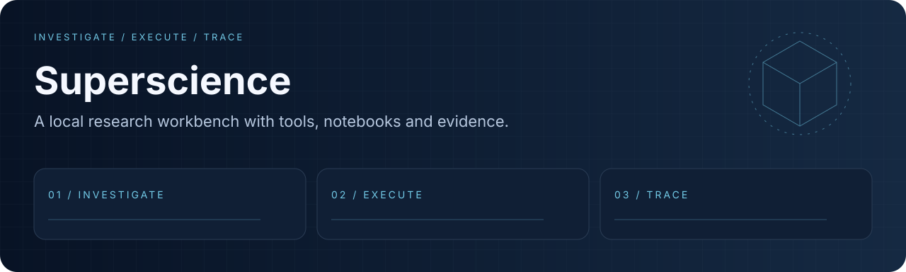
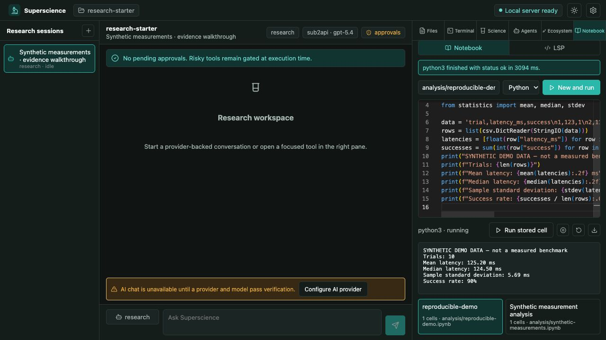
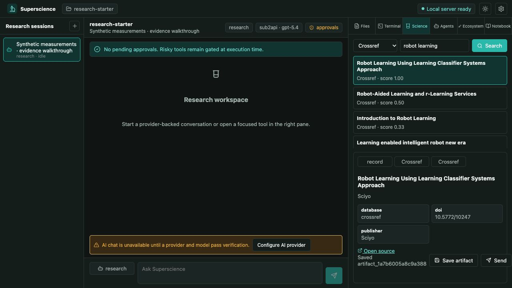
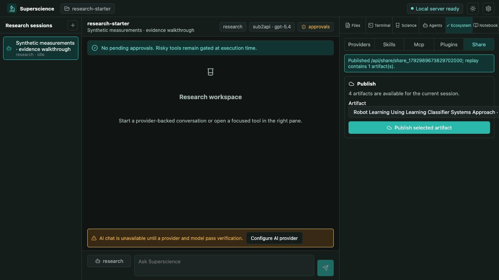
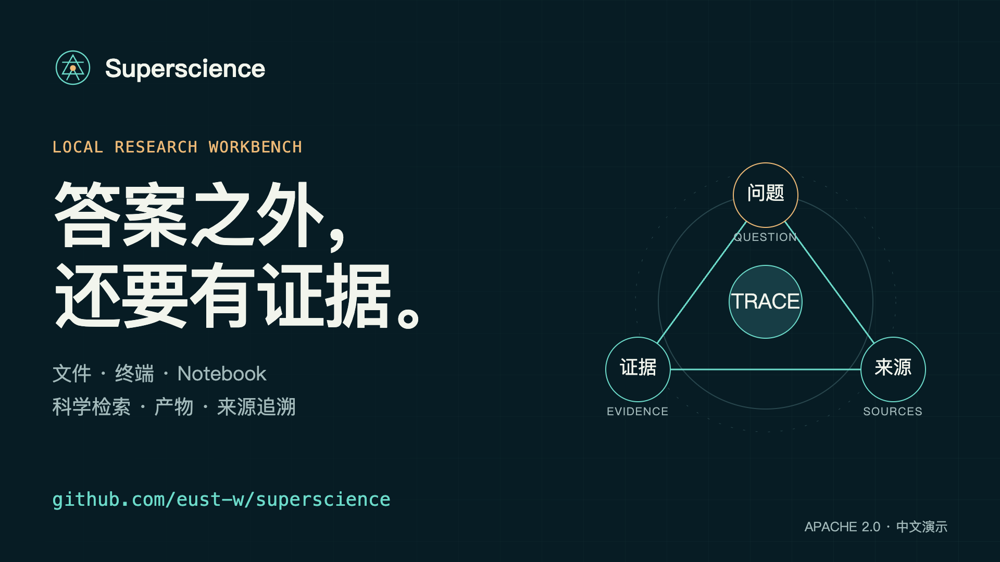
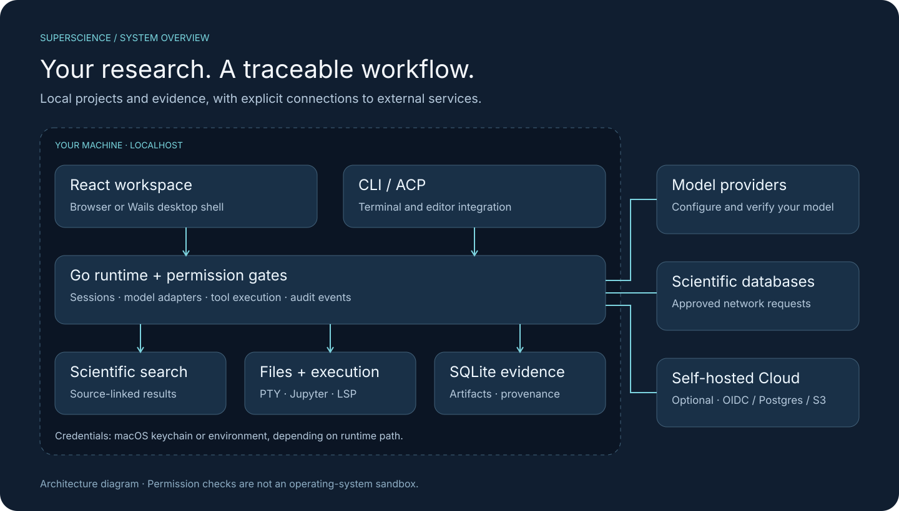

<div align="center">
  
  <h1>Superscience</h1>
  <p><strong>Bring papers, code and research evidence into one local AI workbench.</strong></p>
  <p>
    <a href="https://github.com/eust-w/superscience/actions/workflows/ci.yml"></a>
    <a href="LICENSE"></a>
    <a href="docs/readme/validation.md"></a>
  </p>
  <p><a href="#quick-start">Quick start</a> · <a href="#see-the-workflow">Workflow</a> · <a href="docs/architecture.md">Architecture</a> · <a href="CONTRIBUTING.md">Contribute</a> · <a href="https://github.com/eust-w/superscience/releases">Releases</a></p>
  <p><strong>English</strong> · <a href="README.zh-CN.md">简体中文</a></p>
</div>

Research moves between papers, terminals, notebooks and chat windows. Superscience puts those tools in a shared project workspace and keeps artifacts connected to their sources. Your project files and session database stay on your machine; model calls and scientific searches use the providers you configure.

**Start without an API key:** choose **Open local tools** to explore files, scientific search and notebooks. AI chat stays disabled until a provider and model pass verification. The included [research starter](examples/research-starter/) gives you a reproducible first project.

**Research preview:** the project is available as source. See the [validation record](docs/readme/validation.md) for executed checks and the [release process](docs/releasing.md) for distribution requirements. A supported connector or build target does not by itself establish live-service or signed-desktop acceptance.

## Why Superscience

| Bring together | What you can do |
| :--- | :--- |
| **Research and sources** | Search a catalog of 51 scientific connectors spanning literature, datasets, physics, astronomy, materials, robotics and life sciences; inspect returned metadata and source links. |
| **Code and computation** | Work with project files, a real PTY terminal, stateful Jupyter notebooks and language-server diagnostics. |
| **Models and tools** | Configure model providers, custom agents, tool permissions, Skills and MCP connections. |
| **Results and provenance** | Save artifacts, inspect provenance records and export or replay selected research bundles. |
| **Browser and desktop** | Use the React workbench through a local Go server or the Wails desktop shell. CLI and ACP entry points share the backend runtime. |
| **Optional team infrastructure** | Run the separate self-hosted Cloud service with OIDC, PostgreSQL and S3-compatible storage. |

The connector count describes registered implementations. External services have their own availability, credentials, rate limits and terms. Superscience returns source failures explicitly instead of filling in fabricated results.

## See the workflow



*Actual local-tools workflow: a real Python kernel analyzes ten explicitly synthetic measurements. The model provider was unavailable, so AI chat remains disabled. [Run this example](examples/research-starter/).*

<details>
<summary>Live literature search and a local share replay</summary>



*Crossref returned 20 records for “robot learning”; the selected record was saved with its source DOI.*



*The selected artifact was published to the local server and its replay verified. This is not a hosted Cloud deployment.*

</details>

[](https://x.com/eustancewu/status/2114581844570321022)

[Watch the 81-second introduction — X](https://x.com/eustancewu/status/2114581844570321022) · [抖音](https://www.douyin.com/video/7700838064293186851) · [小红书主页](https://www.xiaohongshu.com/user/profile/5c6f6397000000001103bb3f) · [Video source / 视频源码](media/launch/)

[Download the 1080p / vertical films, subtitles and covers](https://github.com/eust-w/superscience/releases/tag/v0.1.0-alpha.1) — source and media prerelease; no signed desktop installers.

1. **Investigate.** Choose **Open local tools**, open a project, then search a scientific source. Inspect the record and its source URL before saving it as an artifact. Verify a provider later when you want AI assistance.
2. **Execute.** Use the notebook or terminal to analyze your material. Review permission requests before a network, write or execution action proceeds.
3. **Trace.** Keep outputs with their provenance, select the artifacts to share, and export a bundle for inspection or replay.



*Architecture illustration; see the [component map and data boundaries](docs/architecture.md).*

## Quick start

Install **Go 1.26.10 or newer**, the minimum declared in [`go.mod`](go.mod), plus Node.js 24 and pnpm 11.7.0, then run:

```bash
git clone https://github.com/eust-w/superscience.git
cd superscience
pnpm install --frozen-lockfile
pnpm --dir frontend build
go run ./cmd/superscience serve
```

Open **http://127.0.0.1:4096/** and choose **Open local tools**. Open `examples/research-starter` as a project to browse the CSV and run its Python or notebook example. Its 10 synthetic measurements produce a mean latency of **125.20 ms**; these are invented demonstration values, not a performance benchmark.

For AI chat, choose a provider, enter an accessible model ID and API key, and complete verification. Provider usage may incur normal charges. The UI currently stores credentials through **macOS Keychain**; Linux and Windows can use the [environment-backed CLI path](docs/getting-started.md#environment-backed-cli) for provider execution while native credential-store support remains a roadmap item. Local tools do not require that credential setup, but scientific search still requires network access.

For Python notebooks, install the worker and a kernel before starting the server:

```bash
python3 -m venv .venv
.venv/bin/python -m pip install -r workers/python/requirements.txt
.venv/bin/python -m ipykernel install --prefix "$PWD/.venv" --name python3
export SUPERSCIENCE_PYTHON="$PWD/.venv/bin/python"
export JUPYTER_PATH="$PWD/.venv/share/jupyter"
go run ./cmd/superscience serve
```

See [Getting started](docs/getting-started.md) for isolated data directories, frontend development, R/Julia kernels, desktop builds, CLI usage and troubleshooting.

## Trust and verification

Superscience is a workbench with permission controls. Approved notebooks, shell commands, MCP servers and language servers run with your OS user's privileges. Use a container or VM when you need process isolation; read [SECURITY.md](SECURITY.md) before handling untrusted material or deploying Cloud.

```bash
pnpm --dir frontend exec playwright install chromium
make verify
```

The verification target covers Go race tests, vet and vulnerability scanning; frontend types, tests and build; browser acceptance tests; a production dependency audit; and the production-placeholder scan. Browser E2E uses a named localhost protocol fixture, which tests integration without claiming real-model quality. Current outcomes and remaining limits are recorded in [validation notes](docs/readme/validation.md).

Launch verification includes actual Jupyter execution and a live Crossref search. The attempted provider check returned HTTP 503, so no successful external-model response is claimed. These are separate acceptance results.

## Roadmap and contributions

Useful next contributions include native credential storage on Linux/Windows, broader live connector acceptance, complete workspace localization, and signed desktop distribution. These are work areas, not claims of shipped functionality or promised dates.

Start with a reproducible bug, a documented connector, a tested permission boundary or a clearer example. Read the [contribution guide](CONTRIBUTING.md), [report a bug](https://github.com/eust-w/superscience/issues/new?template=bug_report.yml) or [propose a feature](https://github.com/eust-w/superscience/issues/new?template=feature_request.yml). If the workbench is useful to you, a star helps others discover it.

## Documentation

| Guide | Contents |
| :--- | :--- |
| [Getting started](docs/getting-started.md) | Setup, provider credentials, notebooks, CLI and troubleshooting |
| [Architecture](docs/architecture.md) | Components, request flow, storage and extension points |
| [Contributing](CONTRIBUTING.md) | Development loop, focused verification and review expectations |
| [Security](SECURITY.md) | Permission boundaries, private reporting and deployment guidance |
| [Releasing](docs/releasing.md) | Packaging, checksums, signing and publication |
| [Validation](docs/readme/validation.md) | Recorded checks and explicit acceptance boundaries |

## License and acknowledgments

Original repository code and original demo assets use [Apache-2.0](LICENSE). Dependencies, models, datasets and external resources retain their own terms; see [THIRD_PARTY_NOTICES.md](THIRD_PARTY_NOTICES.md).

The product boundary is inspired by OpenScience. Superscience is implemented with Go, Wails and React. The ignored `reference/` directory is a local analysis aid and is not part of the distributed source.
