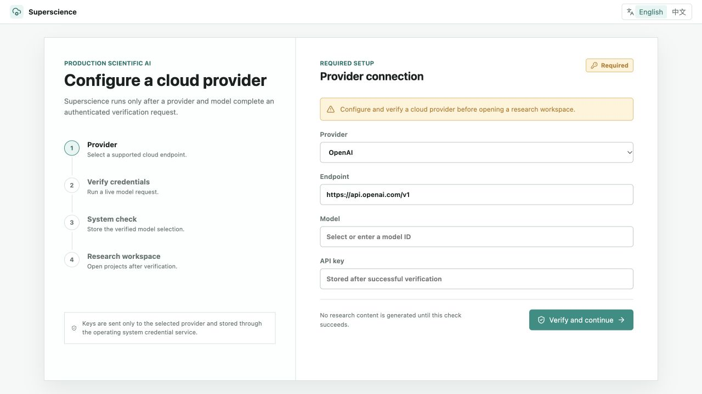

<div align="center">
  
  <h1>Superscience</h1>
  <p><strong>集工具、Notebook 与证据记录于一体的本地科研工作台。</strong></p>
  <p><a href="LICENSE"></a> <a href="docs/readme/validation.md"></a></p>
  <p><a href="#overview">项目亮点</a> · <a href="#quick-start">快速开始</a> · <a href="#workflow">工作流</a> · <a href="#validation">验证</a> · <a href="#documentation">文档</a></p>
  <p><a href="README.md">English</a> · <a href="README.zh-CN.md">简体中文</a></p>
</div>

---

<a id="overview"></a>
## 项目亮点

Go/Wails/React 科研工作区，包含项目、助手会话、文件、PTY 终端、Notebook、科学检索与可检查产物。产品边界受到 OpenScience 启发，本仓库包含独立实现。

| 能力 | 内容 |
| :--- | :--- |
| **本地工具** | 文件编辑、真实终端、权限与持久会话。 |
| **科研工作区** | 模型适配器、科学检索目录、Notebook 与 LSP 接入。 |
| **证据记录** | 产物、来源记录与可选自托管分享。 |

### 本地演示



*首次供应商配置页面，本次未发送外部模型请求。*

<a id="quick-start"></a>
## 快速开始

```bash
git clone https://github.com/eust-w/superscience.git
cd superscience
# Requires Go 1.25+, Node.js 24 and pnpm 11.7.0.
pnpm install --frozen-lockfile
pnpm --dir frontend build
go run ./cmd/superscience serve
# Open http://127.0.0.1:4096/
```

首次进入需配置供应商和模型并完成认证校验；正式界面不会预先生成科研内容。E2E 使用本机协议替身，不代表真实云模型已验收。

<a id="workflow"></a>
## 工作流

```text
INVESTIGATE → EXECUTE → TRACE
```

```bash
python3 -m venv .venv
.venv/bin/python -m pip install -r workers/python/requirements.txt
.venv/bin/python -m ipykernel install --prefix "$PWD/.venv" --name python3
export SUPERSCIENCE_PYTHON="$PWD/.venv/bin/python"
export JUPYTER_PATH="$PWD/.venv/share/jupyter"
make verify
```

<a id="validation"></a>
## 验证

```bash
make verify
```

运行环境与已执行结果见 [validation notes](docs/readme/validation.md).

| 项目 | 当前边界 |
| :--- | :--- |
| 模型供应商 | 适配器和协议测试不等于所有供应商都已实机验收。 |
| Notebook / LSP | 需要 Jupyter 内核和 language server；权限控制不是进程沙箱。 |
| 分发 | 桌面签名、云部署与外部模型凭据属于独立配置。 |

<a id="documentation"></a>
## 文档

- [Security / 安全边界](SECURITY.md)
- [Documentation / 文档](docs/)
- [Notebook worker / Notebook worker](workers/python/)

## 许可证与来源

原创代码和新增演示资源采用 [Apache-2.0](LICENSE). 第三方代码、模型、数据和外部资源保留各自许可，详见 [THIRD_PARTY_NOTICES.md](THIRD_PARTY_NOTICES.md).
