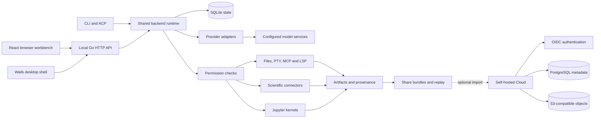

# Architecture

Superscience combines a local application runtime with optional external providers and an optional self-hosted sharing service. Browser, desktop, CLI and ACP entry points reuse the same backend components.

The first-run screen offers **Open local tools** when the local backend is healthy. This opens the project launcher without declaring a model ready: files, scientific search and notebook execution stay available, while AI chat remains disabled until provider/model verification succeeds. Source network requests and local execution still pass through their normal permission checks.

*Concept illustration. It describes component relationships, not a screenshot or a promise of deployed infrastructure.*

## Component map

## Where to find the code

| Component | Responsibility | Source |
| :--- | :--- | :--- |
| Workbench | Setup, project launcher, chat and tool panels | [`frontend/src`](../frontend/src/) |
| Desktop | Wails window, native menu and lifecycle | [`main.go`](../main.go), [`app.go`](../app.go) |
| CLI | Local server, runs, credentials, bundles, ACP and release commands | [`cmd/superscience`](../cmd/superscience/) |
| Runtime / API | Service startup, routes and API boundary validation | [`internal/runtime`](../internal/runtime/), [`internal/server`](../internal/server/) |
| State | SQLite sessions, projects, settings, artifacts and audit records | [`internal/store`](../internal/store/) |
| Providers / agents | Provider resolution, model calls and multi-step runs | [`internal/providers`](../internal/providers/), [`internal/agent`](../internal/agent/) |
| Tools / permissions | Tool registry, execution and approval records | [`internal/tools`](../internal/tools/), [`internal/permissions`](../internal/permissions/) |
| Science | Source-specific requests and normalized results | [`internal/science`](../internal/science/) |
| Notebooks | Stateful execution and kernel management | [`internal/notebook`](../internal/notebook/), [`workers/python`](../workers/python/) |
| Extensions | MCP transports, Skills, plugins and language servers | [`internal/mcp`](../internal/mcp/), [`internal/skills`](../internal/skills/), [`internal/plugins`](../internal/plugins/), [`internal/lsp`](../internal/lsp/) |
| Sharing / Cloud | Bundle schema, replay and optional hosted storage | [`internal/share`](../internal/share/), [`cloud`](../cloud/) |

## A source-to-result path

A scientific search request is checked against the network permission policy. If approval is needed, the API returns a permission reference and the UI asks the user to approve and retry. A connector then queries its upstream service and normalizes the response into records containing source and provenance metadata.

Saving a selected result creates an artifact. Notebook execution separately records its output and the relation between the output and its source notebook. Share bundles include selected artifacts; replay reads those records for inspection. These records help preserve the research trail, but do not establish that a scientific conclusion is correct.

The chat interface currently streams assistant messages through its message API. The multi-step agent runtime also has separate run, event, step and tool-call endpoints. A design document depicting a unified research graph or complete run timeline should not be read as evidence that every proposed UI view is implemented.

## Data and execution boundaries

| Boundary | Current behavior |
| :--- | :--- |
| Local state | SQLite lives under the OS configuration directory, or `SUPERSCIENCE_DATA_DIR` when set. Project files remain in the selected folder. |
| Provider secrets | The resolver reads environment variables, then the configured secret backend. Native persistence currently uses macOS Keychain. API responses do not include stored secret values. |
| Local HTTP | The workbench listens on loopback and applies local Host/Origin guards. |
| File access | File APIs validate paths against the active project root. |
| Approved execution | Shell commands, kernels, MCP servers and language servers inherit OS-user privileges. Approval is not process isolation. |
| External requests | Providers and scientific sources receive the information required by their respective requests. Local storage does not imply offline inference. |
| Sharing | A local bundle/replay stays on the local server unless explicitly transferred. Cloud is a separate service and deployment. |
| Cloud production | PostgreSQL holds metadata; S3-compatible storage holds artifact content. OIDC verifies identity before application tokens are issued. |

Cloud replay/export reads and checks stored artifact objects. Public links can be revoked through Cloud's API. Production acceptance still requires validating your identity provider, storage, transport security and deployment configuration.

## Extension points

- **Providers:** adapt a model API behind `internal/providers`; preserve streaming, tool-call and error behavior across UI, CLI and ACP entry points.
- **Scientific sources:** add a connector and normalization tests to `internal/science`; preserve source URLs and distinguish no records from upstream failures.
- **Agents and Skills:** custom agent definitions persist in SQLite; Skills can be discovered and loaded through the runtime's registries.
- **MCP and plugins:** configure reviewed external tools and their permissions. MCP supports stdio, legacy SSE and Streamable HTTP transports through the Go SDK.
- **Notebook / LSP:** use installed kernels and language servers; registration alone does not install the required executables.

The local API route inventory is available at `/api/openapi.json` or through `go run ./cmd/superscience generate openapi`. It is a route inventory, not a complete request/response schema for client generation. Read the route handlers and tests when integrating a specific operation.

## Validation model

Unit tests and protocol fixtures check deterministic behavior. Browser tests exercise a real Go/SQLite process with a clearly identified test provider. Live model calls, upstream connector availability, signed desktop applications and production Cloud infrastructure require independent acceptance evidence.

Use the [validation record](readme/validation.md) for completed checks, [Getting started](getting-started.md) for local setup, and [SECURITY.md](../SECURITY.md) for security reporting and deployment boundaries.
